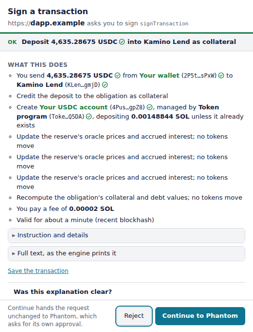
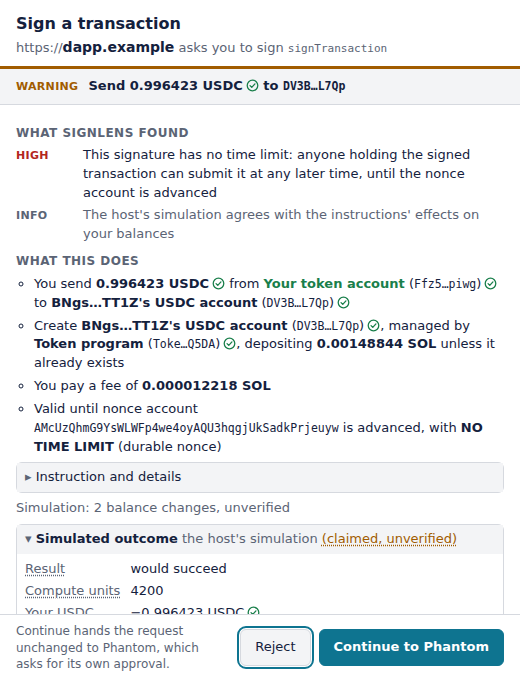
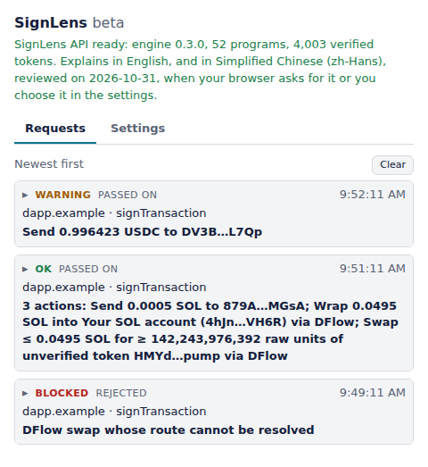

<p align="center">
  
</p>

<h1 align="center">SignLens</h1>

<p align="center">
  <strong>See what a Solana transaction does before you sign it.</strong><br>
  Not only what leaves your wallet, but where it goes and what for.
</p>

<p align="center">
  <a href="https://chromewebstore.google.com/detail/signlens-beta/anihjjfeahahigbnjonlacmboeeolnmk"></a>
  <a href="https://addons.mozilla.org/firefox/addon/signlens-beta/"></a>
  <a href="https://github.com/signlens/signlens-extension/actions/workflows/ci.yml"></a>
  <a href="LICENSE"></a>
</p>

<p align="center">
  <picture>
    <source media="(prefers-color-scheme: dark)" srcset="docs/images/deposit-dark.png">
    
  </picture>
</p>

SignLens works beside the Solana wallet you already use: Phantom,
Backpack, Solflare or another. In a dapp, connect SignLens in its place.
Each request then opens SignLens's window first, in plain words, and goes
on to your wallet only once you say so. Your wallet asks you to approve
or reject, as it always has. SignLens holds no keys and signs nothing.

- **Every instruction, in words.** Deposits, swaps, liquidity positions,
  stakes, perps orders, multisig proposals: who sends what to whom, the
  fee, and how long the signature stays valid.
- **Warns about what a balance preview can't show.** Spending rights,
  accounts handed to a new owner, signatures that never expire,
  lookalike addresses.
- **Blocks what it can't read.** A program it doesn't know is shown as
  unknown and blocked, never called safe.
- **Leaves your wallet in charge.** Your wallet gets the exact bytes
  SignLens explained; a page that changes its transaction afterwards
  changes nothing.
- **Open source, built reproducibly.** Everything that runs in your
  browser is in this repository, and a release rebuilds to the same bytes.

In English and Simplified Chinese, for Chrome, Brave, Edge and Firefox.

> **Beta.** The explanation is computed on SignLens's server, which sees
> each transaction and keeps the verdict and the finding codes, not the
> bytes. [Privacy](#privacy) says what leaves your browser.

## One preview, five different transactions

Before you sign, your wallet shows what a transaction will take from you:
4,635.29 USDC, say. It does not say where that goes or what it buys. A
deposit into a lending market, a liquidity position, a stake, a
leveraged order and a drain can all look the same there. SignLens reads
the transaction itself, every instruction of it, and says in words what
it does.

Some mainnet transactions, by what leaves the wallet and by SignLens's
summary of them:

| On | Leaves your wallet | SignLens says |
|---|---|---|
| Kamino | 4,635.28675 USDC | Deposit 4,635.28675 USDC (verified) into Kamino Lend as collateral |
| Raydium | 33.874114 USDC, 0.00985543 GOOGLx | Open a Raydium CLMM position with ≤ 0.00985543 GOOGLx (verified) and ≤ 33.874114 USDC (verified) |
| Orca | 2.0004 SOL, 0.0019912 ETH | Open an Orca Whirlpool position from tick -54248 to tick -54240; Add ≤ 2.0004 SOL (verified) and ≤ 0.0019912 ETH (verified) to an Orca Whirlpool position |
| Jito | 0.0511 SOL | Stake 0.0511 SOL in a stake pool for its pool token, at the pool's ratio at execution |
| Jupiter | 1.922511449 SOL | Place a long Jupiter Perps limit order of 10457.567852 USD with 1.922511449 SOL collateral, triggered below 117.5 USD |

Under the summary the window lists each step: who sends what to whom
("You send 4,635.28675 USDC from Your wallet to Kamino Lend"), the fee,
how long the signature stays valid, and the details, such as the pool the
stake goes to, named by its token ("JitoSOL stake pool"), and the account
the JitoSOL lands in, yours. "(verified)" marks a token or an account
SignLens knows by its address, not by the name it gives itself; "≤" an
amount the program may take less of.

## What a balance preview can't show

Some of the worst transactions take nothing when you sign them, so a
balance preview shows nothing at all: they hand over the right to take it
later. SignLens names them in the window, right under the verdict:

- **Spending rights.** "Lets … spend an UNLIMITED amount from this token
  account at any time", or up to an amount, without asking again.
- **Accounts given away.** Your token account, or your wallet account
  itself, handed to a new owner or to a program, which then controls
  everything in it. SignLens blocks these.
- **Signatures that never expire.** A transaction built on a durable nonce
  stays valid until the nonce is used, so whoever holds it can send it
  next month; the window says "Valid FOREVER".
- **Lookalike addresses.** An address that shares only its first and last
  four characters with one of your own or a contact's in your address
  book: the address-poisoning trick.
- **A swap paying out elsewhere.** "The swap's output goes to an account
  that is not yours."
- **Programs it does not know.** Shown as unknown and blocked, never
  called safe.

<p align="center">
  <picture>
    <source media="(prefers-color-scheme: dark)" srcset="docs/images/window-dark.png">
    
  </picture>
</p>

## Four verdicts

| Verdict | What it means |
|---|---|
| **OK** | SignLens read every instruction and found nothing beyond notes. |
| **Warning** | Findings to read before you approve, shown first. |
| **Blocked** | Something critical, or a part of the transaction it cannot explain. SignLens refuses it unless you choose "Continue anyway", then answer yes when it asks again, saying why. |
| **Error** | No explanation to show: the API was away, say. Nothing is known about the transaction, so it is treated as blocked, never as a pass; "Try again" asks once more. |

A simulation on your RPC is shown as what the RPC claims, not as fact,
and held against the decoded instructions: more leaving than they state
is a finding. The popup keeps your recent requests and what became of
them.

<p align="center">
  <picture>
    <source media="(prefers-color-scheme: dark)" srcset="docs/images/popup-dark.png">
    
  </picture>
</p>

## Install

| Browser | From the store |
|---|---|
| Chrome, Brave, Edge (111 or later) | [Chrome Web Store](https://chromewebstore.google.com/detail/signlens-beta/anihjjfeahahigbnjonlacmboeeolnmk) |
| Firefox (140 or later) | [Firefox Add-ons](https://addons.mozilla.org/firefox/addon/signlens-beta/) |

Edge installs from the Chrome Web Store once "Allow extensions from other
stores" is on.

Or from a release, to run the very bytes you can check: download
`signlens-extension-X.Y.Z.zip` (Chrome) or
`signlens-extension-firefox-X.Y.Z.zip` (Firefox) from the
[releases](https://github.com/signlens/signlens-extension/releases), and
check it as [Verifying a package](#verifying-a-package) says.

- Chromium browsers: unzip it, open `chrome://extensions`, turn on
  "Developer mode", choose "Load unpacked" and pick the unzipped folder.
- Firefox: open `about:debugging#/runtime/this-firefox`, choose "Load
  Temporary Add-on…" and pick the zip. Firefox keeps an add-on loaded
  this way only until it restarts; one that stays installed comes from
  Firefox Add-ons.

From the sources: [`DEVELOPMENT.md`](DEVELOPMENT.md) says how to build
both and load them.

Firefox lets you withhold an add-on's access to sites: if the popup or the
setup page says the browser has not let the extension reach the API, the
RPC and the token list, press "Allow https access" there, or nothing can
be explained.

## Get started

1. **Add your addresses.** A new install opens a setup page: your wallet
   addresses go there, so the explanation can call them "you". It also
   shows how to pin SignLens, and what leaves your browser.
2. **Connect "SignLens" in a dapp**, where you would pick your wallet. It
   connects through your wallet; on a page with several, it asks once
   which one signs.
3. **Read, then decide.** Each request opens SignLens's window: the
   verdict, a one-line summary, and what the transaction does to you,
   step by step. Reject, or continue to your wallet, which asks you as
   usual.

The popup's settings change the wallet behind SignLens, switch to
watch-only mode (connect as any address, explain, refuse), turn off "Show
the explanation and ask first" so the window opens only for what SignLens
would refuse, keep an address book, and point SignLens at your own RPC.
[Using SignLens](docs/guide.md) has every detail: connecting, what the
window shows, and what each setting does.

## How it works

SignLens registers itself as a
[Wallet Standard](https://github.com/anza-xyz/wallet-standard) wallet that
holds no keys: a dapp sends it what it wants signed, SignLens explains it
in its own window, and once you say so the request goes unchanged to the
wallet you actually sign with. You approve or reject there as usual.
SignLens only watches.

```
dapp ──signTransaction──▶ SignLens wallet ──bytes──▶ SignLens API ──▶ explanation window
                              │                     └─ lookup tables, simulation, accounts ◀── your RPC
                              └─ "Continue" ──▶ your wallet (Phantom, Backpack, …) ──▶ signs
```

Everything that runs in your browser is in this repository, in TypeScript,
compiled file for file with no bundler, so the shipped scripts line up with
the sources. A release package is built reproducibly and published with
its SHA-256; see [Verifying a package](#verifying-a-package).

### What it isn't

- **Not a wallet.** It holds no keys and signs nothing. Your wallet still
  asks you for every signature, as it did before.
- **Not a guarantee.** OK means SignLens read every instruction and found
  nothing to warn about, not that a trade is a good one or a token worth
  holding. It can be wrong, and the strip under each explanation is where
  to say so.
- **Not a guess.** What it cannot read, it says it cannot read, and
  blocks rather than fill in. A simulation is shown as what the RPC
  claims, not as fact.
- **Not offline, in this beta.** The explanation is computed on
  SignLens's server, which sees the transaction; [Privacy](#privacy) says
  what it keeps.
- **Solana mainnet only.**

## Works with

SignLens explains the programs below, whichever site calls them: a
Jupiter swap reads the same on jup.ag as in another site's swap widget.

- **Jupiter**: Aggregator v6, Order Engine, Limit Order v2, Perpetuals,
  Lend (Earn, Borrow, Flashloan), Lock, DAO staking and governance, Genie
  and merkle distributors, prediction market, Doves oracle
- **Kamino**: Lend, Lending Vault, Farms, Limit Orders, Scope
- **Meteora**: DLMM, DAMM v2, Dynamic Bonding Curve, Alpha Vault, Zap,
  liquidity distributor
- **Raydium**: AMM v4, CPMM, CLMM, LaunchLab, router
- **Orca**: Whirlpool
- **marginfi** (Project 0)
- **Pump**: Pump.fun, PumpSwap, Pump Fees, Pump stables router
- **Stake pools**: SPL Stake Pool, which Jito's JitoSOL and many others
  run on
- **MetaDAO**: Futarchy, Conditional Vault
- **Squads**: v4 multisig, the transaction inside a proposal included
- **Aggregators and routers**: DFlow, Titan, OKX DEX Router, 0x Settler,
  LI.FI, Rango, Binance router and fee router, Kobayashi router, Liquid
  Mesh router
- **Lighthouse**, the checks some wallets add to a transaction
- **Solana's own programs**: SOL transfers, tokens and Token-2022,
  associated token accounts, native staking, compute budget and fees,
  memos, lookup tables, program deploys and upgrades

A program not on the list is shown as unknown, and its transaction
blocked. SignLens is not affiliated with any of these projects; their
names are their owners' trademarks.

## Privacy

In short:

- **To the SignLens API**, for each transaction to explain: the
  transaction, the addresses its lookup tables load, the simulation's
  outcome, your addresses, and the addresses in your address book, so it
  can tell a contact from a lookalike. The names in your address book
  stay in your browser: each goes as a random stand-in.
- **Kept by the API**: of an explanation, the verdict, the finding codes,
  the program names, the size, the latency and a hash of the message;
  what a rating sends; and the transaction only if you tick "Send this
  transaction to SignLens so it can be looked into" under its
  explanation.
- **Your IP address** is seen by Cloudflare, as for any site it serves.
  The API takes it only to count your requests against its limit, in
  memory and as a keyed hash, and logs it nowhere.
- **Your RPC**, by default the public `solana-rpc.publicnode.com`, is
  asked for lookup tables, simulates the transaction, and reads the
  accounts an explanation names; unlisted tokens are looked up there and
  in a token list, by default Jupiter's. Simulation, account lookup and
  token lookup can each be turned off, and the RPC and the token list
  can be your own.
- **Ratings** send nothing until you give one, and the strip says what a
  rating sends first.
- **Messages to sign** never leave the extension. The dapp learns neither
  the explanation nor its verdict.

Every request and what it carries: [Privacy](docs/guide.md#privacy) in
Using SignLens, and the policy at <https://signlens.dev/privacy>.

## Verifying a package

A release is a tag `vX.Y.Z` on the default branch that names the version in
`package.json`, and whose version has a section in `CHANGELOG.md`: that
section is the release's notes (`node scripts/release-notes.ts X.Y.Z`
shows them). CI runs every test, the end-to-end suite against the API
included, runs `npm ci && npm run package`, and attaches
`signlens-extension-X.Y.Z.zip` (Chrome) and
`signlens-extension-firefox-X.Y.Z.zip`, each with its `.sha256`, to the
release, with a build provenance attestation. A package is a store-only
zip with sorted entries and fixed timestamps, so the same source gives the
same bytes anywhere; CI builds it on Linux, macOS and Windows and compares.

In the directory you downloaded the release's files to, check each
package against its `.sha256` and its attestation:

```sh
sha256sum -c signlens-extension-X.Y.Z.zip.sha256 signlens-extension-firefox-X.Y.Z.zip.sha256
# on macOS: shasum -a 256 -c signlens-extension-X.Y.Z.zip.sha256 signlens-extension-firefox-X.Y.Z.zip.sha256
gh attestation verify signlens-extension-X.Y.Z.zip --owner signlens
gh attestation verify signlens-extension-firefox-X.Y.Z.zip --owner signlens
```

Rebuilt from the tag, both come out the same bytes; check them against the
release's `.sha256` files from the `dist/` the build writes to:

```sh
git checkout vX.Y.Z && npm ci && npm run package
cd dist && sha256sum -c ~/Downloads/signlens-extension-X.Y.Z.zip.sha256 ~/Downloads/signlens-extension-firefox-X.Y.Z.zip.sha256
```

The stores publish the release's files with a signature of their own
added, so what they install is not the zip byte for byte.

## Reporting a problem

An explanation that read wrong or unclear: the feedback strip under it,
which is what it is for. A bug in the extension: an issue in this
repository. A way to make SignLens show a transaction as something it is
not, pass a request on without your decision, or send what it says it
does not: not an issue, but an email to security@signlens.dev, as
[`SECURITY.md`](SECURITY.md) says.

To build, test or change it: [`DEVELOPMENT.md`](DEVELOPMENT.md) and
[`CONTRIBUTING.md`](CONTRIBUTING.md).

## License

Copyright 2026 Boris Onchev. Apache-2.0, see [`LICENSE`](LICENSE).
