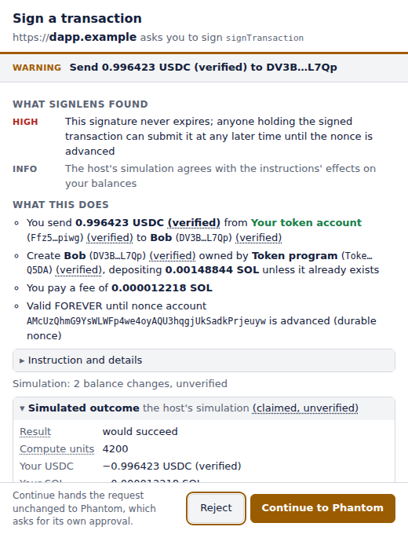
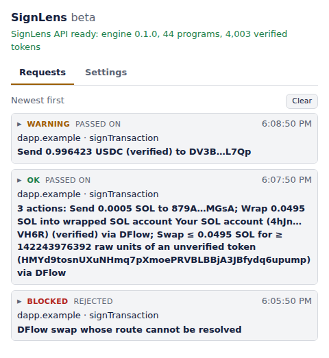

# SignLens for the browser

[](https://github.com/signlens/signlens-extension/actions/workflows/ci.yml)
[](LICENSE)

See what a Solana transaction does before you sign it. SignLens registers
itself as a [Wallet Standard](https://github.com/anza-xyz/wallet-standard)
wallet that holds no keys: a dapp sends it what it wants signed, SignLens
explains it in its own window, and once you say so the request goes
unchanged to the wallet you actually sign with. You approve or reject there
as usual. SignLens only watches.

<p align="center">
  
  
</p>

**Beta.** In this version the explanation is computed by SignLens's server:
the extension sends it the transaction with what it read itself (the
addresses the transaction's lookup tables load, the outcome of a simulation
on the RPC in the settings) and renders the answer. The server keeps
verdicts and finding codes, not the bytes; the transaction itself is kept
only when you tick "Send this transaction to SignLens so it gets covered"
on one SignLens did not call OK. The end goal is the same explanation
computed inside the extension, offline. Asking for it is one function in
one module (`explainRemotely` in `src/worker/api.ts`); the feedback strip, the API
status and the API address in the settings are the server's and would go
with it.

```
dapp ──signTransaction──▶ SignLens wallet ──bytes──▶ SignLens API ──▶ explanation window
                              │                     └─ lookup tables, simulation ◀── your RPC
                              └─ "Continue" ──▶ your wallet (Phantom, Backpack, …) ──▶ signs
```

Everything that runs in your browser is in this repository, in TypeScript,
compiled file for file with no bundler, so the shipped scripts line up with
the sources. A release package is built reproducibly and published with
its SHA-256; see [Verifying a package](#verifying-a-package).

## Install

Chromium browsers (Chrome, Brave, Edge, 111 or later): `npm install && npm
run build`, open `chrome://extensions`, turn on "Developer mode", choose
"Load unpacked" and pick the `dist/chrome/` directory. Firefox (128 or
later): `npm run build:firefox`, open `about:debugging#/runtime/this-firefox`,
choose "Load Temporary Add-on…" and pick `dist/firefox/manifest.json`.
Firefox lets you withhold an add-on's access to sites: if the popup says
the browser has not let the extension reach the API, the RPC and the token
list, press "Allow https access" there, or nothing can be explained.
`npm run package` builds the store packages for both.

In a dapp, connect "SignLens". By default it connects to the first other
wallet it finds in the page and passes every request on after explaining
it; the popup's settings pick the wallet from the ones found in the current
tab, switch to watch-only mode (connect as any address, explain, refuse),
turn off "Show the explanation and ask first" (in pass-through mode the
window still opens for what SignLens would refuse), list your own
addresses, keep an address book, and point the extension at another RPC or API (https, or plain http to this
machine only). A connect that finds no
wallet to pass to is refused and shown in the popup's requests, with the
wallets that were there. A dapp has to connect before it can ask for
anything, and asks one thing at a time: a second request while the first is
open is refused.

In watch-only mode no wallet stands behind SignLens to ask you before a
site learns the address, so SignLens asks: the first time a site connects,
a window shows which site wants to see which address, Deny first. An Allow
is kept for that site and that address; a Deny is not, and the site asks
again the next time it connects. Either way the popup's requests keep the
answer. A dapp reconnecting silently as it loads gets the address only
where you allowed it. The settings list the sites, those allowed for an
address you watched before marked so, and Revoke disconnects a site's open
pages. No page is told the watched address otherwise, whatever the mode.

The explanation calls "you" only addresses you gave SignLens: in
pass-through mode the ones under "Your addresses" in the settings, in
watch-only mode the watched one. The page says which address signs a
transaction, and a page can name its own, so that sending to it would
read as a move between your accounts. Before a transaction is explained,
SignLens checks the address the page names: in pass-through mode, one
that is not among yours opens a window with it beside yours, Reject
first. Reject refuses the request; "It's mine, add it" adds the address
to your settings and the request goes on to be explained. One yes is one
address: a request that names more than one not among yours is refused,
since a page could put yours beside its own. With "Show the explanation
and ask first" off, no window opens for it: the request is refused, and
your addresses go in the settings first. In watch-only mode a request
that names another address is refused. A message is not checked, since
nothing in it is explained as yours.

What goes to your wallet is SignLens's own copy of the bytes it explained,
taken when the dapp asked: a page that changes its transaction afterwards
changes nothing. The dapp is told whether the request was passed on,
rejected by you, or refused by SignLens and why (still busy with the
page's last request, its window could not open, no decision in time),
never the verdict or the explanation, since they depend on your address
book.

## What you see

Every request opens a window before it reaches your wallet, once SignLens
has read what it needs and asked the API. With "Show the explanation and
ask first" off, it opens, in pass-through mode, only for a request SignLens
would refuse (blocked, or an error); the rest go on as explained, and the
popup keeps them, marked "passed on, not asked". The verdict and the one-line summary stay at the top and
the buttons at the bottom; in between, the findings, what the transaction
does to you as a list ("You send 0.5 SOL to …", "You pay a fee of …",
"Valid FOREVER until …"), each instruction with its fields, and the full
text under toggles. A request of several transactions shows each under its
own heading, and the summary at the top is the most serious one's. The
window's title carries the verdict and the site, so the window is known by
them in the taskbar.

The verdict is one of four:

- **OK**: nothing beyond notes.
- **Warning**: findings to read before you approve, shown first.
- **Blocked**: the engine found something critical, or a part of the
  transaction it cannot explain (an unknown program, say), and will not
  call it safe. SignLens refuses it unless you choose "Continue anyway".
- **Error**: SignLens has no explanation to show. The API was away or
  refused, or answered with something that does not hold together, or with
  a verdict this version does not know. Nothing is known about the
  transaction, so it is treated as blocked, never as a pass.

An effect or a value of a kind this version does not know is shown as one,
not left out. Closing the window, or the dapp's page, refuses the request.
Under the explanation, a strip asks whether it was clear.

Simulation runs on your RPC and is shown as what it is, an unverified
claim held against the decoded instructions: more leaving than they state
is a finding, agreement is a quiet line. Tokens outside SignLens's verified
list are named from the RPC and a token list as claims, marked unverified.

## Privacy

Each request to explain a transaction sends the SignLens API the
transaction, the addresses its lookup tables load, the outcome of the
simulation if it ran, your addresses from the settings (in watch-only
mode the watched one, so the explanation can say "you"), and your
address book, names and
addresses, so contacts can be named; when the explanation leaves tokens
unnamed and token lookup is on, it asks again with their symbols. This
happens when the dapp asks, before the window opens, and also when "Show
the explanation and ask first" is off.

The RPC in the settings, by default the public
`solana-rpc.publicnode.com`, is asked for the lookup tables of every
transaction that uses any, sees the whole transaction when simulation is
on, and the mints of unlisted tokens when token lookup is on. Those mints
also go to the token list, by default Jupiter's `lite-api.jup.ag`.
Simulation and token lookup are on by default; the settings turn them off.
A transaction the dapp names as for another chain than mainnet goes to the
same RPC all the same, since the name is only the dapp's word; the window
shows the chain it named.

The API logs the verdict, the finding codes, the program names, the size,
the latency and a hash of the message, and stores nothing else; bytes are
kept only when you send them through the feedback strip.

The feedback strip sends nothing until you rate an explanation. A rating
sends, for each transaction explained: the rating, your comment (up to
2,000 characters, the same for each), the explanation's digest (a hash of
the transaction's message), and the transaction itself only if you
ticked "Send this transaction to SignLens so it gets covered", which is
offered only on one SignLens did not call OK. It goes to the API in the
settings when you rate "Clear", or when you decide, closing the window
included. Messages to sign
never leave the extension, and the dapp learns neither the explanation nor
its verdict, nor, in watch-only mode, the watched address until you allow
it.
The settings show each address, and you can run your own.

## Development

Node 26.1 or later (`npm test` runs the files in a random order, which Node 26 takes from 26.1).
`nvm use` picks it from `.nvmrc`, and `npm ci` refuses an older Node (`.npmrc`).

```sh
npm install
npm run check           # Biome (lint and format, the stylesheet included) and the TypeScript compiler, strict
npm test                # in Node: every module but the pages, the worker's against the stub RPC and a fake chrome; in a random order, seed printed
npm run build           # dist/chrome: the files in static/, and tsc's script for each source, one file each
npm run test:e2e        # the extension in Chromium, against the API's recorded answers
npm run test:e2e:record # the same against a running SignLens API, recording its answers anew
npm run screenshots     # the README's images, of the real window and popup on recorded explanations
npm run package         # the Chrome and Firefox packages under dist/, with their SHA-256s
```

The end-to-end tests load the unpacked extension into Chromium, serve a
test dapp and a stub RPC on localhost, and answer the API calls with what a
running SignLens API answered them, recorded under `test/fixtures/api/` (one
file per call: its method, path and body), counting them and refusing them
when a test asks. A call nothing was recorded for fails its test, and the
browser resolves no host but this machine, so the suite needs no network.
With `SIGNLENS_API_URL` set, the calls go to that API instead, and each
answer is held against its recording: every value recorded must still be
there, the same (a field the API added, or a newer token snapshot, is
not a change). One that departs is reported at the end of the run, as a
warning (in GitHub Actions, an annotation and a line on the run's
summary page); with
`SIGNLENS_STRICT_RECORDINGS=1`, as a release runs, it fails its test.
Feedback is never sent, live or not.
`npm run test:e2e:record` runs the suite that way and records every answer
anew (`SIGNLENS_API_URL`, default `http://127.0.0.1:8787`). The fixtures
under `test/fixtures` are mainnet transactions and what the API made of
them.

On every change CI runs the lint, the types, the Node tests and the
end-to-end suite, and builds the package on Linux, macOS and Windows,
which must come out the same bytes. When the repository variable
`SIGNLENS_API_URL` names an API, the suite also runs against it; a
release requires that.

## Layout

`src/` is split by where the code runs, since each place has its own
browser APIs and rules. Each module's Node test sits beside it.

| | |
|---|---|
| `src/page/` | runs in the dapp's page, as classic scripts that import nothing |
| | `injected.ts`: the Wallet Standard wallet in the page, its copy of the request, and the hand-off to the real one |
| | `content.ts`: relays between the page and the extension |
| | `page.d.ts`: the types those two share with the modules, which they cannot import |
| `src/worker/` | the background service worker |
| | `background.ts`, `alive.ts`: keeps the wallets each page has and routes the messages; stays up while it holds a request |
| | `requests.ts`: a page's request answered: explained, shown, decided on, kept |
| | `explain.ts`, `tables.ts`, `simulation.ts`, `hints.ts`: what a request is explained with: the lookup tables and the simulation over your RPC, names for unlisted tokens, and the API's answer as rows |
| | `api.ts`, `explanation.ts`: the API client, and the explanation document as this version reads it, checked field by field or refused with where it fails |
| | `gate.ts`, `history.ts`: the window and the user's decision; the popup's history and the badge |
| | `sites.ts`: in watch-only mode, the sites allowed to see the watched address, and the window that asks |
| | `feedback.ts`: the feedback records |
| | `solana.ts`: the little of Solana's wire format the worker needs |
| `src/ui/` | the extension's own pages |
| | `popup.ts`, `pages.ts`: the popup; the pages SignLens runs on, and what the popup says over one it does not |
| | `confirm.ts`, `connect.ts`, `address.ts`, `windows.ts`, `dom.ts`: the window, the window that asks to show a site the watched address, the one that asks whether an address is yours, and what they share |
| | `render.ts`: one row of a request as the window and the popup show it |
| `src/shared/` | what the worker and the pages both use, and nothing of either |
| | `types.ts`: the contract: the explanation document, the request, the feedback record, the API's status |
| | `model.ts`: what SignLens keeps of a request: its rows (explained, failed, a message, a site asking, an address not yours) and what became of it |
| | `messages.ts`: the messages and who may send what |
| | `store.ts`: the extension's storage, typed by key, and the queue its read-then-write changes go through |
| | `settings.ts`, `endpoint.ts`: the settings and their defaults; the endpoints accepted, checked again at each use |
| | `verdict.ts`: the verdict words and which is worst, for the badge and the window |
| | `text.ts`, `json.ts`, `base58.ts`: text from elsewhere made safe to show; objects read from elsewhere; addresses |
| `src/manifest.test.ts`, `src/layout.test.ts` | the manifest, the Firefox manifest, and the host permissions against the endpoint rule; the folders, and what each may import |
| `static/` | the manifest, the pages, the stylesheet and the icons, copied as they are into the build |
| `docs/images/` | the README's screenshots, made by `npm run screenshots` (`e2e/screenshots.shot.ts`) |
| `dist/` | what the build makes, never committed: `chrome/` (the unpacked extension, the scripts in the folders they have under `src/`), `firefox/`, and the packages |
| `scripts/` | the Firefox copy, the reproducible packages, and recording the API's answers for the end-to-end tests |
| `e2e/` | the end-to-end tests, in Chromium, and the harness that loads the extension and opens its windows; at the end of a run against a live API, which recordings it no longer matches |
| `test/` | what the Node tests and the end-to-end tests share: the mainnet transactions and the API's recorded answers (`fixtures/`), the stub RPC and API relay, the test dapp it serves, and the stand-in for the `chrome` APIs the modules run against in Node |

## Verifying a package

A release is a tag `vX.Y.Z` on the default branch that names the version in
`package.json`. CI runs every test, the end-to-end suite against the API
included, runs `npm ci && npm run package`, and attaches
`signlens-extension-X.Y.Z.zip` (Chrome) and
`signlens-extension-firefox-X.Y.Z.zip`, each with its `.sha256`, to the
release, with a build provenance attestation. A package is a store-only
zip with sorted entries and fixed timestamps, so the same source gives the
same bytes anywhere; CI builds it on Linux, macOS and Windows and compares.

In the directory you downloaded the release's files to, check each
package against its `.sha256` and its attestation:

```sh
sha256sum -c signlens-extension-X.Y.Z.zip.sha256 signlens-extension-firefox-X.Y.Z.zip.sha256
# on macOS: shasum -a 256 -c signlens-extension-X.Y.Z.zip.sha256 signlens-extension-firefox-X.Y.Z.zip.sha256
gh attestation verify signlens-extension-X.Y.Z.zip --owner signlens
gh attestation verify signlens-extension-firefox-X.Y.Z.zip --owner signlens
```

Rebuilt from the tag, both come out the same bytes; check them against the
release's `.sha256` files from the `dist/` the build writes to:

```sh
git checkout vX.Y.Z && npm ci && npm run package
cd dist && sha256sum -c ~/Downloads/signlens-extension-X.Y.Z.zip.sha256 ~/Downloads/signlens-extension-firefox-X.Y.Z.zip.sha256
```

## License

Copyright 2026 Boris Oncev. Apache-2.0, see [`LICENSE`](LICENSE).
