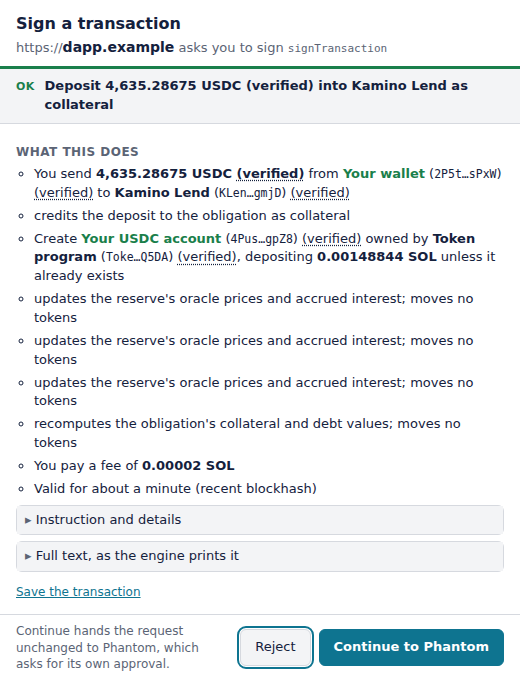
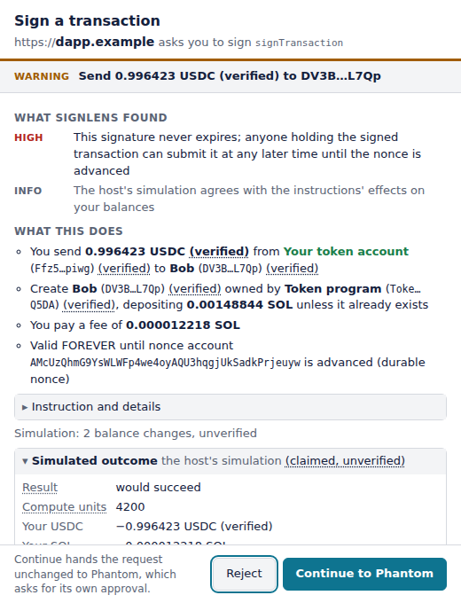
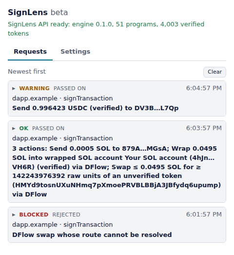

# SignLens for the browser

[](https://github.com/signlens/signlens-extension/actions/workflows/ci.yml)
[](LICENSE)

See what a Solana transaction does before you sign it: not only what
leaves your wallet, but where it goes and what for. SignLens works beside
the Solana wallet you already use (Phantom, Backpack, …). It holds no
keys: it explains each request in its own window, and once you say so
passes it on to your wallet, where you approve or reject as usual.

<p align="center">
  <picture>
    <source media="(prefers-color-scheme: dark)" srcset="docs/images/deposit-dark.png">
    
  </picture>
</p>

**Beta.** In this version the explanation is computed by SignLens's server:
the extension sends it the transaction with what it read itself (the
addresses the transaction's lookup tables load, the outcome of a simulation
on the RPC in the settings, the accounts the explanation names) and renders
the answer. The server keeps
verdicts and finding codes, not the bytes; the transaction itself is kept
only when you tick "Send this transaction to SignLens so it can be looked
into" under its explanation.

## Why

Before you sign, your wallet can show what a transaction will take from
you: 4,635.29 USDC, say. It does not say where that goes or what it buys.
A deposit into a lending market, a liquidity position, a stake, a
leveraged order and a drain can all look the same there. SignLens reads
the transaction itself, every instruction of it, and says in words what
it does, before your wallet asks you to sign.

Some mainnet transactions, by what leaves the wallet and by SignLens's
summary of them:

| On | Leaves your wallet | SignLens says |
|---|---|---|
| Kamino | 4,635.28675 USDC | Deposit 4,635.28675 USDC (verified) into Kamino Lend as collateral |
| Raydium | 33.874114 USDC, 0.00985543 GOOGLx | Open a Raydium CLMM position with ≤ 0.00985543 GOOGLx (verified) and ≤ 33.874114 USDC (verified) |
| Orca | 2.0004 SOL, 0.0019912 ETH | Open an Orca Whirlpool position from tick -54248 to tick -54240; Add ≤ 2.0004 SOL (verified) and ≤ 0.0019912 ETH (verified) to an Orca Whirlpool position |
| Jito | 0.0511 SOL | Stake 0.0511 SOL in a stake pool for its pool token, at the pool's ratio at execution |
| Jupiter | 1.922511449 SOL | Place a long Jupiter Perps limit order of 10457.567852 USD with 1.922511449 SOL collateral, triggered below 117.5 USD |

Under the summary the window lists each step: who sends what to whom
("You send 4,635.28675 USDC from Your wallet to Kamino Lend"), the fee,
how long the signature stays valid, and the details, such as the pool the
stake goes to, named by its token ("JitoSOL stake pool"), and the account
the JitoSOL lands in, yours. "(verified)" marks a token or an account
SignLens knows by its address, not by the name it gives itself; "≤" an
amount the program may take less of.

## It also warns you

Some of the worst transactions take nothing when you sign them, so a
balance preview shows nothing at all: they hand over the right to take it
later. SignLens names them in the window, right under the verdict:

- **Spending rights.** "Lets … spend an UNLIMITED amount from this token
  account at any time", or up to an amount, without asking again.
- **Accounts given away.** Your token account, or your wallet account
  itself, handed to a new owner or to a program, which then controls
  everything in it. SignLens blocks these.
- **Signatures that never expire.** A transaction built on a durable nonce
  stays valid until the nonce is used, so whoever holds it can send it
  next month; the window says "Valid FOREVER".
- **Lookalike addresses.** An address that shares only its first and last
  four characters with one of your own or a contact's in your address
  book: the address-poisoning trick.
- **A swap paying out elsewhere.** "The swap's output goes to an account
  that is not yours."
- **Programs it does not know.** Shown as unknown and blocked, never
  called safe.

<p align="center">
  <picture>
    <source media="(prefers-color-scheme: dark)" srcset="docs/images/window-dark.png">
    
  </picture>
</p>

## How it works

SignLens registers itself as a
[Wallet Standard](https://github.com/anza-xyz/wallet-standard) wallet that
holds no keys: a dapp sends it what it wants signed, SignLens explains it
in its own window, and once you say so the request goes unchanged to the
wallet you actually sign with. You approve or reject there as usual.
SignLens only watches.

```
dapp ──signTransaction──▶ SignLens wallet ──bytes──▶ SignLens API ──▶ explanation window
                              │                     └─ lookup tables, simulation, accounts ◀── your RPC
                              └─ "Continue" ──▶ your wallet (Phantom, Backpack, …) ──▶ signs
```

Everything that runs in your browser is in this repository, in TypeScript,
compiled file for file with no bundler, so the shipped scripts line up with
the sources. A release package is built reproducibly and published with
its SHA-256; see [Verifying a package](#verifying-a-package). How to
build and test it from the sources is in
[`DEVELOPMENT.md`](DEVELOPMENT.md).

## What it isn't

- **Not a wallet.** It holds no keys and signs nothing. Your wallet still
  asks you for every signature, as it did before.
- **Not a guarantee.** OK means SignLens read every instruction and found
  nothing to warn about, not that a trade is a good one or a token worth
  holding. It can be wrong, and the strip under each explanation is where
  to say so.
- **Not a guess.** What it cannot read, it says it cannot read, and
  blocks rather than fill in. A simulation is shown as what the RPC
  claims, not as fact.
- **Not offline, in this beta.** The explanation is computed on
  SignLens's server, which sees the transaction; [Privacy](#privacy) says
  what it keeps.
- **Solana mainnet only.**

## Works with

SignLens explains the programs below, whichever site calls them: a
Jupiter swap reads the same on jup.ag as in another site's swap widget.

- **Jupiter**: Aggregator v6, Order Engine, Limit Order v2, Perpetuals,
  Lend (Earn, Borrow, Flashloan), Lock, DAO staking and governance, Genie
  and merkle distributors, prediction market, Doves oracle
- **Kamino**: Lend, Lending Vault, Farms, Limit Orders, Scope
- **Meteora**: DLMM, DAMM v2, Dynamic Bonding Curve, Alpha Vault, Zap,
  liquidity distributor
- **Raydium**: AMM v4, CPMM, CLMM, LaunchLab, router
- **Orca**: Whirlpool
- **marginfi** (Project 0)
- **Pump**: Pump.fun, PumpSwap, Pump Fees, Pump stables router
- **Stake pools**: SPL Stake Pool, which Jito's JitoSOL and many others
  run on
- **MetaDAO**: Futarchy, Conditional Vault
- **Squads**: v4 multisig, the transaction inside a proposal included
- **Aggregators and routers**: DFlow, Titan, OKX DEX Router, 0x Settler,
  LI.FI, Rango, Binance router and fee router, Kobayashi router, Liquid
  Mesh router
- **Lighthouse**, the checks some wallets add to a transaction
- **Solana's own programs**: SOL transfers, tokens and Token-2022,
  associated token accounts, native staking, compute budget and fees,
  memos, lookup tables, program deploys and upgrades

A program not on the list is shown as unknown, and its transaction
blocked. SignLens is not affiliated with any of these projects; their
names are their owners' trademarks.

## Install

From a release: download `signlens-extension-X.Y.Z.zip` (Chrome) or
`signlens-extension-firefox-X.Y.Z.zip` (Firefox) from the
[releases](https://github.com/signlens/signlens-extension/releases), and
check it as [Verifying a package](#verifying-a-package) says.

- Chromium browsers (Chrome, Brave, Edge, 111 or later): unzip it, open
  `chrome://extensions`, turn on "Developer mode", choose "Load unpacked"
  and pick the unzipped folder.
- Firefox (140 or later): open `about:debugging#/runtime/this-firefox`,
  choose "Load Temporary Add-on…" and pick the zip. Firefox keeps an
  add-on loaded this way only until it restarts; one that stays installed
  comes from addons.mozilla.org, once SignLens is there.

From the sources: [`DEVELOPMENT.md`](DEVELOPMENT.md) says how to build
both and load them.

Firefox lets you withhold an add-on's access to sites: if the popup says
the browser has not let the extension reach the API, the RPC and the token
list, press "Allow https access" there, or nothing can be explained.

## Using it

In a dapp, connect "SignLens". By default it connects to the first other
wallet it finds in the page and passes every request on after explaining
it; the popup's settings pick the wallet from the ones found in the current
tab, switch to watch-only mode (connect as any address, explain, refuse),
turn off "Show the explanation and ask first" (in pass-through mode the
window still opens for what SignLens would refuse), list your own
addresses, keep an address book, and point the extension at another RPC
or API (https, or plain http to this machine only). A connect that finds
no wallet to pass to is refused and shown in the popup's requests, with
the wallets that were there. A dapp has to connect before it can ask for
anything, and asks one thing at a time: a second request while the first is
open is refused.

In watch-only mode no wallet stands behind SignLens to ask you before a
site learns the address, so SignLens asks: the first time a site connects,
a window shows which site wants to see which address, Deny first. An Allow
is kept for that site and that address; a Deny is not, and the site asks
again the next time it connects. Either way the popup's requests keep the
answer. A dapp reconnecting silently as it loads gets the address only
where you allowed it. The settings list the sites, those allowed for an
address you watched before marked so, and Revoke disconnects a site's open
pages. No page is told the watched address otherwise, whatever the mode.

The explanation calls "you" only addresses you gave SignLens: in
pass-through mode the ones under "Your addresses" in the settings, in
watch-only mode the watched one. A request carries at most 8 of yours,
past that those the page names first, and the first 64 contacts of the
address book: each costs the API work, and it refuses more. The page says which address signs a
transaction, and a page can name its own, so that sending to it would
read as a move between your accounts. Before a transaction is explained,
SignLens checks the address the page names: in pass-through mode, one
that is not among yours opens a window with it beside yours, Reject
first. Reject refuses the request; "It's mine, add it" adds the address
to your settings and the request goes on to be explained. One yes is one
address: a request that names more than one not among yours is refused,
since a page could put yours beside its own. With "Show the explanation
and ask first" off, no window opens for it: the request is refused, and
your addresses go in the settings first. In watch-only mode a request
that names another address is refused. A message is not checked, since
nothing in it is explained as yours.

What goes to your wallet is SignLens's own copy of the bytes it explained,
taken when the dapp asked: a page that changes its transaction afterwards
changes nothing. The dapp is told whether the request was passed on,
rejected by you, or refused by SignLens and why (still busy with the
page's last request, its window could not open, no decision in time),
never the verdict or the explanation, since they depend on your address
book.

## What you see

Every request opens a window before it reaches your wallet, once SignLens
has read what it needs and asked the API. With "Show the explanation and
ask first" off, it opens, in pass-through mode, only for a request SignLens
would refuse (blocked, or an error); the rest go on as explained, and the
popup keeps them, marked "passed on, not asked". The verdict and the
one-line summary stay at the top and the buttons at the bottom; in
between, the findings, what the transaction does to you as a list ("You
send 0.5 SOL to …", "You pay a fee of …", "Valid FOREVER until …"), each
instruction with its fields, and the full text under toggles. A request
of several transactions shows each under its own heading, and the summary
at the top is the most serious one's. The window's title carries the
verdict and the site, so the window is known by them in the taskbar.

<p align="center">
  <picture>
    <source media="(prefers-color-scheme: dark)" srcset="docs/images/popup-dark.png">
    
  </picture>
</p>

The verdict is one of four:

- **OK**: nothing beyond notes.
- **Warning**: findings to read before you approve, shown first.
- **Blocked**: the engine found something critical, or a part of the
  transaction it cannot explain (an unknown program, say), and will not
  call it safe. SignLens refuses it unless you choose "Continue anyway".
- **Error**: SignLens has no explanation to show. The API was away or
  refused, or answered with something that does not hold together, or with
  a verdict this version does not know. No answer at all, or a 502, 503 or
  530 (what a deploy, a restart or a busy server looks like), is tried
  once more after a pause of half a second, or of what the API's
  `Retry-After` asks for up to two, before it counts. The API explains
  ten transactions a minute for each address it is asked from (a request
  of several counts each), and refuses more, which shows as an error
  until a few seconds have passed. Nothing is known about the
  transaction, so it is treated as blocked, never as a pass.

An effect or a value of a kind this version does not know is shown as one,
not left out. Closing the window, or the dapp's page, refuses the request.
Under the explanation, a strip asks whether it was clear.

Simulation runs on your RPC and is shown as what it is, an unverified
claim held against the decoded instructions: more leaving than they state
is a finding, agreement is a quiet line. Tokens outside SignLens's verified
list are named from the RPC and a token list as claims, marked unverified.
Some instructions depend on an account they name: approving a multisig
proposal made in an earlier transaction signs a reference to it, and the
transaction it runs is stored on chain; a Jupiter DAO vote signs a side's
number, and the proposal says which option that is. The explanation then
names the accounts it would read; SignLens reads them from your RPC and
asks again, and shows what they hold as the RPC's claim, which never
lowers a finding.

## Privacy

Each request to explain a transaction sends the SignLens API the
transaction, the addresses its lookup tables load, the outcome of the
simulation if it ran, your addresses from the settings (in watch-only
mode the watched one, so the explanation can say "you"), and your
address book, names and
addresses, so contacts can be named. When the explanation names accounts
it would read and account lookup is on, it asks again with those accounts
as the RPC returned them, up to twice; when it leaves tokens unnamed and
token lookup is on, it asks again with their symbols. This
happens when the dapp asks, before the window opens, and also when "Show
the explanation and ask first" is off.

Every request reaches the API through Cloudflare, which sees your IP
address, as it does for any site it serves. The API takes the address
only to count your requests against its limit, in memory and as a keyed
hash, and logs it nowhere.

The RPC in the settings, by default the public
`solana-rpc.publicnode.com`, is asked for the lookup tables of every
transaction that uses any, sees the whole transaction when simulation is
on, the addresses of the accounts an explanation names (a multisig
proposal and the transaction it stores, a DAO proposal and its options)
when account lookup is on, and the mints of unlisted tokens when token
lookup is on. Those mints also go to the token list, by default
Jupiter's `lite-api.jup.ag`. Simulation, account lookup and token lookup
are on by default; the settings turn them off. A transaction the dapp
names as for another chain than mainnet goes to the same RPC all the
same, since the name is only the dapp's word; the window shows the chain
it named.

Of an explanation, the API logs the verdict, the finding codes, the
program names, the size, the latency and a hash of the message, and keeps
nothing else. What a rating sends is kept, as below, and the bytes only
when you send them through the feedback strip.

The feedback strip sends nothing until you rate an explanation, and says
what a rating sends before you give one. A rating sends, for each
transaction explained: the rating, your comment (up to 2,000 characters,
the same for each), the explanation's digest (a hash of the transaction's
message), the site's host and the extension's version (in Firefox only
once you allow them: Firefox asks the first time you rate, and
"Permissions and data" in its add-on manager changes the answer), the
wallet method it called, and what the window showed you: the verdict, the one-line
summary, the findings by code and severity, and the program each
instruction calls, read from the transaction in the extension. The
transaction itself, with the addresses its lookup tables loaded, goes only
if you ticked "Send this transaction to SignLens so it can be looked
into", which is offered under every explanation, unticked, so a rendering
SignLens called OK but you rated wrong can be explained again as you saw
it. It goes to the API in the settings when you rate "Clear", or when
you decide, closing the window included. Messages to sign
never leave the extension, and the dapp learns neither the explanation nor
its verdict, nor, in watch-only mode, the watched address until you allow
it.
The settings show each address. The RPC and the token list can be your
own; the API's address is there for development, since the API's source
is not public.

## Verifying a package

A release is a tag `vX.Y.Z` on the default branch that names the version in
`package.json`, and whose version has a section in `CHANGELOG.md`: that
section is the release's notes (`node scripts/release-notes.ts X.Y.Z`
shows them). CI runs every test, the end-to-end suite against the API
included, runs `npm ci && npm run package`, and attaches
`signlens-extension-X.Y.Z.zip` (Chrome) and
`signlens-extension-firefox-X.Y.Z.zip`, each with its `.sha256`, to the
release, with a build provenance attestation. A package is a store-only
zip with sorted entries and fixed timestamps, so the same source gives the
same bytes anywhere; CI builds it on Linux, macOS and Windows and compares.

In the directory you downloaded the release's files to, check each
package against its `.sha256` and its attestation:

```sh
sha256sum -c signlens-extension-X.Y.Z.zip.sha256 signlens-extension-firefox-X.Y.Z.zip.sha256
# on macOS: shasum -a 256 -c signlens-extension-X.Y.Z.zip.sha256 signlens-extension-firefox-X.Y.Z.zip.sha256
gh attestation verify signlens-extension-X.Y.Z.zip --owner signlens
gh attestation verify signlens-extension-firefox-X.Y.Z.zip --owner signlens
```

Rebuilt from the tag, both come out the same bytes; check them against the
release's `.sha256` files from the `dist/` the build writes to:

```sh
git checkout vX.Y.Z && npm ci && npm run package
cd dist && sha256sum -c ~/Downloads/signlens-extension-X.Y.Z.zip.sha256 ~/Downloads/signlens-extension-firefox-X.Y.Z.zip.sha256
```

## Reporting a problem

An explanation that read wrong or unclear: the feedback strip under it,
which is what it is for. A bug in the extension: an issue in this
repository. A way to make SignLens show a transaction as something it is
not, pass a request on without your decision, or send what it says it
does not: not an issue, but an email to security@signlens.dev, as
[`SECURITY.md`](SECURITY.md) says.

## License

Copyright 2026 Boris Onchev. Apache-2.0, see [`LICENSE`](LICENSE).
