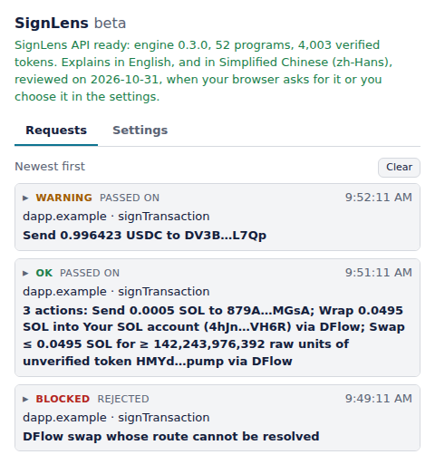

# Using SignLens

How SignLens behaves once it is installed, in full: setting it up and
connecting, what each window shows, and everything that leaves your
browser. The [README](../README.md) has the overview and how to install
it.

## Using it

A new install opens a setup page in a tab of its own: your wallet
addresses go there, so no site has to be asked about first, with how to
use SignLens, how to pin it, and what leaves your browser. An update does
not open it. Your addresses are a list, there and in the popup's
settings: one row each, in full, with Remove, and a field that adds only
a Solana address. While pass-through mode has none, the popup's requests
ask for one inline; its settings open the setup page again.

SignLens is in English and Simplified Chinese, its own words and its
explanations alike: in the first of your browser's languages it has, or
in the one chosen under Language, at the top of the setup page and of
the popup's settings. A browser that asks for Traditional Chinese gets
English unless Simplified Chinese is chosen there.

In a dapp, connect "SignLens". It connects through your wallet and
passes every request on to it after explaining it. Until you have chosen
one, a page with a single wallet gets that one; a page with several asks,
the first time you connect, which one in a window of its own that lists
them with their icons, and keeps your choice (a dapp reconnecting as it
loads asks nothing, and gets the first found). Another SignLens, such as
a store build beside one built from the sources, is never the wallet
behind it. The popup's settings change the wallet, from the ones found
in the current tab, switch to watch-only mode (connect as any address,
explain, refuse), turn off "Show the explanation and ask first" (in
pass-through mode the window still opens for what SignLens would
refuse), list your own addresses, keep an address book, and point the
extension at another RPC or API (https, or plain http to this machine
only). A connect that finds
no wallet to pass to is refused and shown in the popup's requests, with
the wallets that were there. A dapp has to connect before it can ask for
anything, and asks one thing at a time: a second request while the first is
open is refused.

In watch-only mode no wallet stands behind SignLens to ask you before a
site learns the address, so SignLens asks: the first time a site connects,
a window shows which site wants to see which address, Deny first. An Allow
is kept for that site and that address; a Deny is not, and the site asks
again the next time it connects. Either way the popup's requests keep the
answer. A dapp reconnecting silently as it loads gets the address only
where you allowed it. The settings list the sites, those allowed for an
address you watched before marked so, and Revoke disconnects a site's open
pages. No page is told the watched address otherwise, whatever the mode.

The explanation calls "you" only addresses you gave SignLens: in
pass-through mode the ones under "Your addresses" in the settings, in
watch-only mode the watched one. A request carries at most 8 of yours,
past that those the page names first, and the first 64 contacts of the
address book: each costs the API work, and it refuses more. The page says which address signs a
transaction, and a page can name its own, so that sending to it would
read as a move between your accounts. Before a transaction is explained,
SignLens checks the address the page names: in pass-through mode, one
that is not among yours opens a window with it beside yours, Reject
first. Reject refuses the request; "It's mine, add it" adds the address
to your settings and the request goes on to be explained. One yes is one
address: a request that names more than one not among yours is refused,
since a page could put yours beside its own. With "Show the explanation
and ask first" off, no window opens for it: the request is refused, and
your addresses go in the settings first. In watch-only mode a request
that names another address is refused. A message is not checked, since
nothing in it is explained as yours.

What goes to your wallet is SignLens's own copy of the bytes it explained,
taken when the dapp asked: a page that changes its transaction afterwards
changes nothing. The dapp is told whether the request was passed on,
rejected by you, or refused by SignLens and why (still busy with the
page's last request, its window could not open, no decision in time),
never the verdict or the explanation, since they depend on your address
book.

## What you see

Every request opens a window before it reaches your wallet, once SignLens
has read what it needs and asked the API. With "Show the explanation and
ask first" off, it opens, in pass-through mode, only for a request SignLens
would refuse (blocked, or an error); the rest go on as explained, and the
popup keeps them, marked "passed on, not asked". The verdict and the
one-line summary stay at the top and the buttons at the bottom; in
between, the findings, what the transaction does to you as a list ("You
send 0.5 SOL to …", "You pay a fee of …", "Valid FOREVER until …"), each
instruction with its fields, and the full text under toggles. A request
of several transactions shows each under its own heading, and the summary
at the top is the most serious one's. The window's title carries the
verdict and the site, so the window is known by them in the taskbar.

  <picture>
    <source media="(prefers-color-scheme: dark)" srcset="images/popup-dark.png">
    
  </picture>

The verdict is one of four:

- **OK**: nothing beyond notes.
- **Warning**: findings to read before you approve, shown first.
- **Blocked**: the engine found something critical, or a part of the
  transaction it cannot explain (an unknown program, say), and will not
  call it safe. SignLens refuses it unless you choose "Continue anyway",
  then answer yes when it asks again, saying why.
- **Error**: SignLens has no explanation to show. The API was away or
  refused, or answered with something that does not hold together, or with
  a verdict this version does not know. No answer at all, or a 502, 503 or
  530 (what a deploy, a restart or a busy server looks like), is tried
  once more after a pause of half a second, or of what the API's
  `Retry-After` asks for up to two, before it counts. The API explains
  ten transactions a minute for each address it is asked from (a request
  of several counts each), and refuses more, which shows as an error
  until a few seconds have passed; in a request of several, the ones
  after the first refused are not asked for, and say so. Nothing is
  known about the transaction, so it is treated as blocked, never as a
  pass. "Try again" in the window asks once more while the request waits,
  with the settings as they are then, and shows what comes back. A
  request holds 32 transactions at most.

An effect or a value of a kind this version does not know is shown as one,
not left out. Closing the window, or the dapp's page, refuses the request.
Under the explanation, a strip asks whether it was clear.

Simulation runs on your RPC and is shown as what it is, an unverified
claim held against the decoded instructions: more leaving than they state
is a finding, agreement is a quiet line. Tokens outside SignLens's verified
list are named from the RPC and a token list as claims, marked unverified.
Some instructions depend on an account they name: approving a multisig
proposal made in an earlier transaction signs a reference to it, and the
transaction it runs is stored on chain; a Jupiter DAO vote signs a side's
number, and the proposal says which option that is. The explanation then
names the accounts it would read; SignLens reads them from your RPC and
asks again, and shows what they hold as the RPC's claim, which never
lowers a finding.

## Privacy

Each request to explain a transaction sends the SignLens API the
transaction, the addresses its lookup tables load, the outcome of the
simulation if it ran, your addresses from the settings (in watch-only
mode the watched one, so the explanation can say "you"), and the
addresses in your address book, so it can tell a contact from an address
that only looks like one. The names in your address book stay in your
browser: each goes as a random stand-in, new for each request, which
says nothing of the name and which the extension replaces with the name
in what it shows you. When the explanation names accounts it would read
and account lookup is on, it asks again with those accounts as the RPC
returned them, up to twice; when it leaves tokens unnamed and token
lookup is on, it asks again with their symbols. This happens when the
dapp asks, before the window opens, and also when "Show the explanation
and ask first" is off.

Every request reaches the API through Cloudflare, which sees your IP
address, as it does for any site it serves. The API takes the address
only to count your requests against its limit, in memory and as a keyed
hash, and logs it nowhere.

The RPC in the settings, by default the public
`solana-rpc.publicnode.com`, is asked for the lookup tables of every
transaction that uses any, sees the whole transaction when simulation is
on, the addresses of the accounts an explanation names (a multisig
proposal and the transaction it stores, a DAO proposal and its options)
when account lookup is on, and the mints of unlisted tokens when token
lookup is on. Those mints also go to the token list, by default
Jupiter's `lite-api.jup.ag`. Simulation, account lookup and token lookup
are on by default; the settings turn them off. A transaction the dapp
names as for another chain than mainnet goes to the same RPC all the
same, since the name is only the dapp's word; the window shows the chain
it named.

Of an explanation, the API logs the verdict, the finding codes, the
program names, the size, the latency and a hash of the message, and keeps
nothing else. What a rating sends is kept, as below, and the bytes only
when you send them through the feedback strip.

The feedback strip sends nothing until you rate an explanation, and says
what a rating sends before you give one. A rating sends, for each
transaction explained: the rating, your comment (up to 2,000 characters,
the same for each), the explanation's digest (a hash of the transaction's
message), the site's host and the extension's version (in Firefox only
once you allow them: Firefox asks the first time you rate, and
"Permissions and data" in its add-on manager changes the answer), the
wallet method it called, and what the window showed you: the verdict,
the one-line summary, with each of your contacts in it as "a contact",
the findings by code and severity, and the program each
instruction calls, read from the transaction in the extension. The
transaction itself, with the addresses its lookup tables loaded, goes only
if you ticked "Send this transaction to SignLens so it can be looked
into", which is offered under every explanation, unticked, so a rendering
SignLens called OK but you rated wrong can be explained again as you saw
it. It goes to the API in the settings when you rate "Clear", or when
you decide, closing the window included. Messages to sign
never leave the extension, and the dapp learns neither the explanation nor
its verdict, nor, in watch-only mode, the watched address until you allow
it.
The settings show each address. The RPC and the token list can be your
own; the API's address is there for development, since the API's source
is not public.
